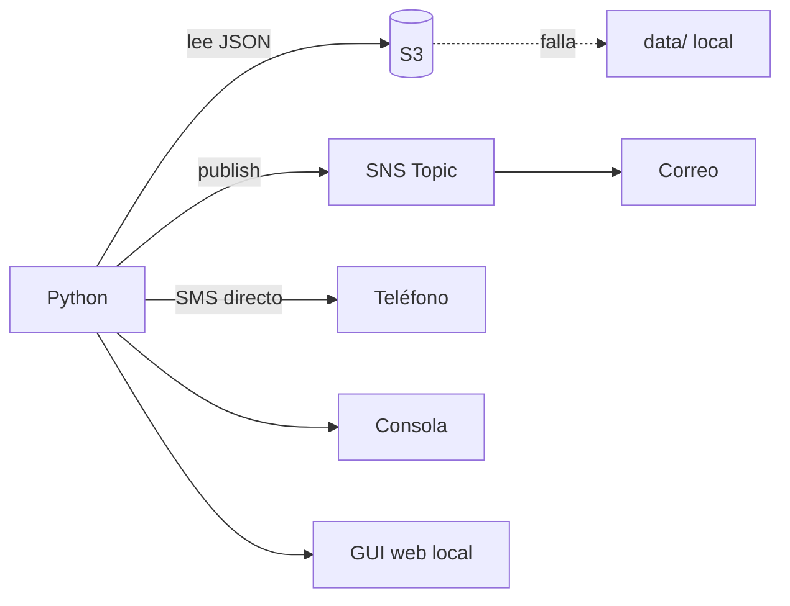

# RutaAlerta

Prototipo en Python para hackatón. Revisa si hay incidentes (transporte retrasado, estación cerrada, calle bloqueada, manifestación o evento) en los tramos de tu ruta habitual y te avisa por consola, correo y SMS. Incluye una interfaz web local.

## Cómo funciona

1. Lee `rutas.json` e `incidentes.json` desde S3. Si S3 falla, usa los archivos de `data/`.
2. Compara cada tramo de la ruta con los incidentes que tienen `"vigente": true`. La comparación ignora mayúsculas, acentos y espacios extra.
3. Si hay incidencias, envía una alerta. En modo `monitor` y en la GUI solo notifica cuando cambia el estado de la ruta, para no repetir avisos.



## Archivos

| Archivo | Función |
|---|---|
| `rutaalerta.py` | Comandos `check`, `aviso`, `monitor` y `gui` |
| `core.py` | Lógica pura: evaluación de la ruta, mensajes y `Vigilante` (anti-spam) |
| `datasource.py` | Lectura desde S3 con respaldo local |
| `notifier.py` | Envío por consola, SNS (correo) y SMS; guarda el historial |
| `gui.py` / `gui.html` | Servidor `http.server` y página de una sola vista |
| `config.py` | Configuración por variables de entorno |
| `setup_s3.py` / `setup_sns.py` | Crean el bucket y el topic en AWS |
| `test_rutaalerta.py` | 12 pruebas unitarias, sin AWS |
| `data/` | Rutas e incidentes de ejemplo |

## Uso rápido (sin AWS)

```powershell
pip install -r requirements.txt
python test_rutaalerta.py
python rutaalerta.py check --local --no-sns
python rutaalerta.py gui --local --no-sns
```

La GUI abre en `http://127.0.0.1:8080/`.

| Comando | Qué hace |
|---|---|
| `check` | Evalúa la ruta una vez |
| `aviso --tipo 1dia` o `10min` | Dispara un aviso manual |
| `monitor --intervalo 10` | Revisa en bucle (Ctrl+C para salir) |
| `gui` | Interfaz web |

Opciones comunes: `--ruta ID`, `--tramos "A, B, C"` (ruta propia), `--local`, `--no-sns`.

## Interfaz web

- La ruta se muestra como una línea vertical de tramos: verde (despejado), naranja (severidad media o baja) y rojo (alta).
- Puedes elegir una ruta, o escribir una propia y guardarla.
- Botones de aviso, cuenta regresiva, hora de la última actualización y origen de los datos (S3 o local).
- `localStorage` guarda en el navegador la ruta elegida, las rutas propias, el historial de notificaciones y la última lectura.

## Despliegue en AWS (us-west-2)

| Servicio | Uso |
|---|---|
| S3 | Guarda `rutas.json` e `incidentes.json` |
| SNS | Topic con suscripción por correo, y SMS directo |

```powershell
$env:RUTAALERTA_BUCKET = "mi-bucket-unico"
$env:RUTAALERTA_EMAIL  = "tucorreo@dominio.com"
python setup_s3.py
python setup_sns.py
$env:RUTAALERTA_TOPIC_ARN = "<arn que imprime setup_sns.py>"
python rutaalerta.py gui
```

Confirma el correo de suscripción de AWS. El SMS es opcional (`RUTAALERTA_SMS`, formato E.164) y en sandbox solo llega a números verificados. Variables disponibles: ver `config.py`.

## Estado del desarrollo

- Hecho: lógica, consola, GUI, scripts de AWS y pruebas. Las 12 pruebas pasan.
- Pendiente de comprobar: S3 y SNS no se probaron contra AWS. Al intentar crear el bucket, una política de la organización (SCP) en la cuenta de prueba negó `s3:CreateBucket`. La app sigue funcionando con los datos locales.
- Límites: los incidentes son datos de ejemplo; los avisos de "1 día" y "10 minutos" se disparan a mano; `monitor` no guarda estado entre ejecuciones.

## Limpieza de recursos AWS

```powershell
aws s3 rm s3://<bucket> --recursive
aws s3api delete-bucket --bucket <bucket> --region us-west-2
aws sns delete-topic --topic-arn <arn> --region us-west-2
```
